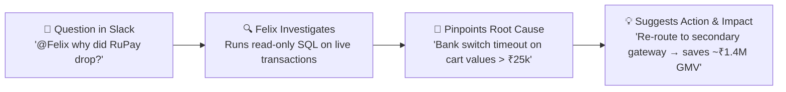
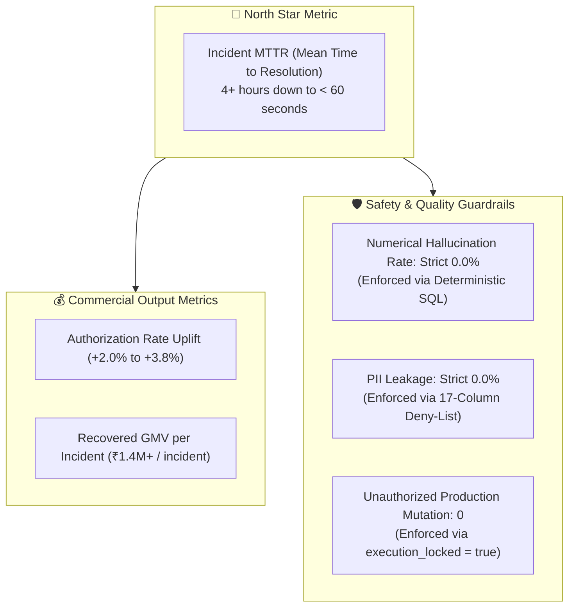
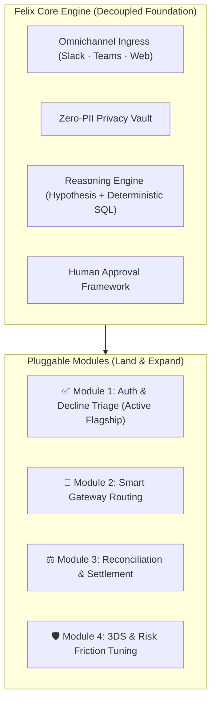

# Felix — AI Incident Analyst for Payment Drops

[](https://felix-payments-agent.onrender.com/)
[](https://payments-team-central.slack.com/archives/C0CGRRPPD99)
[](LICENSE)

> **Felix is an AI incident assistant that lives inside Slack and Microsoft Teams. When payment success rates drop, teams ask Felix what happened. It runs queries on your live transaction database, pinpoints the exact cause in seconds, and suggests an actionable fix.**

[🌐 Open Live Web App](https://felix-payments-agent.onrender.com/) &nbsp;•&nbsp; [💬 Test in Slack (`#payments-incidents`)](https://payments-team-central.slack.com/archives/C0CGRRPPD99)

---

## 💡 The $100M Problem: Unexplained Authorization Bleed

In global digital commerce, 12% to 18% of all payment attempts fail. For a company processing $500M annually, a mere **1% drop in payment authorization means $5,000,000 in lost revenue** every year ($400,000+ every month).

When an authorization drop happens today:
* **Triage takes 4+ hours:** Responders jump into a war room, scramble to write custom SQL queries, or wait for a data analyst ticket while revenue bleeds.
* **Context is scattered:** Discussions happen in Slack, metrics sit in Tableau dashboards, and raw transactions live in a warehouse like Snowflake or Postgres. Teams waste time jumping between tabs.
* **Generic AI can't be trusted:** Standard chatbots hallucinate math and can't touch sensitive customer cardholder data without violating PCI-DSS compliance.

---

## ⚡ The Solution: How Felix Solves It

Instead of scrambling to write manual SQL queries or waiting for dashboards to refresh, someone on the team simply tags Felix in Slack:

> *"@Felix, why did our RuPay approval rate drop in the last 2 hours?"*

Here is what Felix does behind the scenes:



1. **Formulates the hypothesis:** Automatically checks network switch baselines, bank response codes, and ticket sizes.
2. **Runs real read-only SQL:** Queries your transaction database directly. It never guesses or hallucinates numbers.
3. **Isolates the broken cohort:** Pinpoints the exact failure signature (e.g., *RuPay cards + Electronics merchants + Cart values > ₹25,000 + Bank Error Code 91*).
4. **Calculates revenue impact:** Projects the exact GMV you can recover (e.g., *+3.8% approval rate lift = ₹1.4M recovered GMV*).
5. **Prepares an actionable playbook:** Drafts a specific remediation (like shifting traffic to a backup gateway), locked with human approval (`execution_locked: true`).

---

## 🧪 Try It in 30 Seconds (Interactive Incident Scenarios)

You can test Felix directly right now in the [Web App](https://felix-payments-agent.onrender.com/) or in [Slack (`#payments-incidents`)](https://payments-team-central.slack.com/archives/C0CGRRPPD99). Copy and paste any of these real-world prompts:

| Incident Scenario | Copy-paste this prompt | What Felix shows you |
| :--- | :--- | :--- |
| **🧪 1. Diagnose a sudden drop** | `@Felix why did our RuPay approval rate drop in the last 2 hours?` | Finds the bank timeout spike, isolates high-ticket carts, and calculates lost revenue. |
| **🧪 2. Drill down into declines** | `@Felix break down recent declines by bank and error code.` | Groups declines by issuer response codes so you see exactly which bank is failing. |
| **🧪 3. Simulate a fix & ROI** | `@Felix simulate gateway failover to Axis Bank and calculate recovered GMV.` | Models expected approval lift (+3.8%) and drafts an actionable playbook. |

---

## 🧠 Why I Built It This Way (Product & Design Decisions)

As a Product Manager, every technical choice had to solve a specific human or business friction:

### 1. Why Slack and Teams instead of another web dashboard?
* **The Reality:** When payments break at 2 AM, the on-call engineer and product team are already talking in a Slack incident channel. Nobody wants to open a browser, log into Tableau, remember SQL syntax, and apply 10 filters.
* **The Decision:** Bring the analyst to where the team already is. Asking `@Felix` in the existing incident thread keeps everyone on the same page without context switching.

### 2. Why real SQL instead of letting the AI guess the numbers?
* **The Reality:** LLMs are great at language, but terrible at calculating precise financial percentages. A false number during a high-stakes incident destroys trust immediately.
* **The Decision:** Felix uses AI only to understand questions and form hypotheses. 100% of the numbers, percentages, and charts come from deterministic SQL queries run directly on the database. If there is no data, it says so.

### 3. Why require human approval before taking action?
* **The Reality:** Companies will never let an autonomous AI bot automatically re-route live payment traffic. If an AI makes a wrong automated switch, it could bring down checkout entirely.
* **The Decision:** Autonomous diagnosis, but **governed execution**. Felix can identify the problem and draft the fix (like switching gateways), but the action is flagged `execution_locked: true` until an authorized human reviews and approves it.

### 4. How does it protect customer privacy (PCI-DSS)?
* **The Reality:** Customer card numbers (PANs), CVVs, and names can never be sent to third-party AI models.
* **The Decision:** Built-in Zero-PII protection. A strict 17-column filter strips all sensitive cardholder data before the query ever touches an AI model.

---

## 👥 Who Uses Felix & Why

| Role | What they care about | How Felix helps |
| :--- | :--- | :--- |
| **On-Call SRE / Engineer** | Fixing P1 alerts fast at 2 AM | Finds the root cause in 60 seconds without writing manual SQL. |
| **Payment Ops / Product Manager** | Protecting conversion rate & revenue | Shows which bank routes are failing and estimates recoverable GMV. |
| **Merchant Success Manager** | Answering angry merchants | Gives an instant, plain-English breakdown of why a merchant's payments failed. |
| **Fintech Risk & Compliance** | Data security & safety | Guarantees Zero-PII leakage and prevents unsanctioned system mutations. |

---

## 🏆 Competitive Advantage: Felix vs. The Market

| Dimension | Traditional BI (Tableau / Looker) | Generic Chatbots (ChatGPT / Copilot) | Felix Incident Agent |
| :--- | :--- | :--- | :--- |
| **How it investigates** | **Passive:** Shows charts; humans must manually slice and dice | **Text-only:** Gives generic advice; cannot see live data | **Autonomous:** Forms hypotheses, executes queries, pinpoints cohorts |
| **Math accuracy** | High, but requires manual SQL | **Prone to hallucinations:** Guesses percentages | **100% Deterministic:** Grounded directly in live transaction records |
| **Data privacy** | Internal database only | **High risk:** Cardholder data sent to external cloud LLMs | **Zero-PII Vault:** Card numbers never touch external AI models |
| **Where you use it** | Siloed dashboard URL | Separate browser tab | **Native Slack & Teams:** Embedded inside your incident channel |
| **Safety & Control** | Read-only viewing | Unpredictable text generation | **Human Approval Lock:** Cannot modify production without admin review |

---

## 🔌 Decoupled by Design: Any Database, Any Tool, Any Purpose

In simple terms, Felix is built like building blocks so it fits into any company's existing stack without rewrites:

1. **Works with Any Database:** 
   Felix doesn't care where your transactions live. It plugs into **PostgreSQL** or **MySQL** (live transactional DBs), **Snowflake**, **BigQuery**, or **Databricks** (data warehouses), or high-speed engines like **ClickHouse**. For local testing, it runs completely sandboxed on **SQLite**.
2. **Plugs into Any Tool:** 
   Felix can easily trigger notifications in **PagerDuty**, open tickets in **Jira**, broadcast updates to **Slack**, or check health APIs on **Stripe**, **Adyen**, or **Razorpay**.
3. **Adapts to Any Operational Domain:** 
   The core brain handles conversations, security filters, and query execution independently. Switching Felix from analyzing **decline spikes** to **settlement discrepancies** or **refund balancing** requires zero changes to the underlying security or messaging architecture.

---

## 📊 How Success Is Measured (Product Metrics)



---

## 🌐 Live Interactive Demo & Testing

Experience Felix live in production through the executive web console or directly inside Slack:

### Option A: Live Web Console
* **🔗 Live App URL:** [https://felix-payments-agent.onrender.com/](https://felix-payments-agent.onrender.com/)
* Features live Chart.js visualizations, autonomous decline investigations, multi-model failover testing, live logs, and an Enterprise Integrations admin panel.

### Option B: Test Felix Live in Slack
* **💬 Slack Incident Channel:** [👉 Open `#payments-incidents` in Slack](https://payments-team-central.slack.com/archives/C0CGRRPPD99)
* Jump into the channel and ask Felix any question (e.g., `@Felix why did our approval rate drop?`).

---

## 🛠️ Quickstart: Run Locally in 2 Minutes

### Using Docker:
```bash
git clone https://github.com/piyush07rai/felix-payments-agent.git
cd felix-payments-agent
docker compose up --build
```
Open [http://localhost:8000](http://localhost:8000) in your browser.

### Using Python:
```bash
python3 -m venv venv
source venv/bin/activate
pip install -r requirements.txt
cp .env.example .env
uvicorn app.main:app --host 0.0.0.0 --port 8000 --reload
```

---

## 🎯 Platform Vision: Beyond a Single Analyst

Most internal tools start and die as a single dashboard. **Felix is designed with a "Land-and-Expand" product strategy:**

* **The High-ROI Wedge (Today):** *Autonomous Payment Decline Diagnostics*. Solves the immediate, painful problem of unexplained authorization drops in seconds.
* **The Long-Term Platform (Tomorrow):** The exact same chat interface, Zero-PII vault, and reasoning engine naturally expand across the entire payments lifecycle:
  * **Smart Gateway Routing:** Dynamically recommend acquirer traffic splits to lower interchange fees and maximize uptime.
  * **Reconciliation & Settlement:** Automatically catch ledger mismatches, delayed bank payout batches, and missing settlements.
  * **3DS & Risk Tuning:** Spot checkout friction in 3D Secure challenges without hurting fraud detection.



---

## 📄 License

Distributed under the Apache 2.0 License. Built for real-world payment operations and practical AI incident triage.
