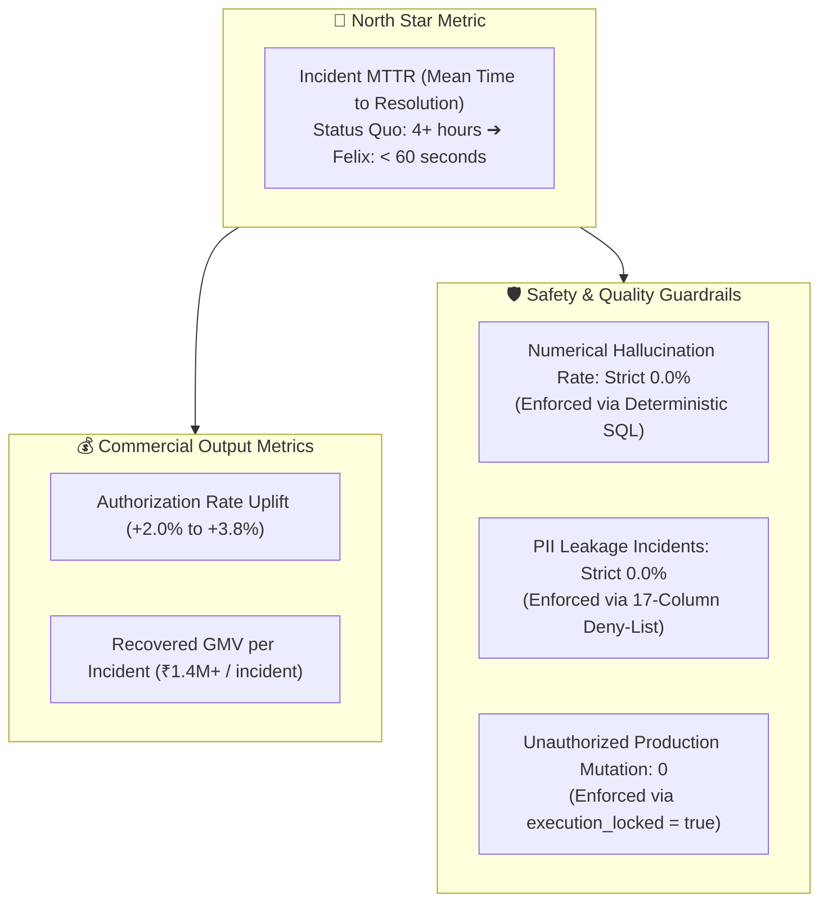
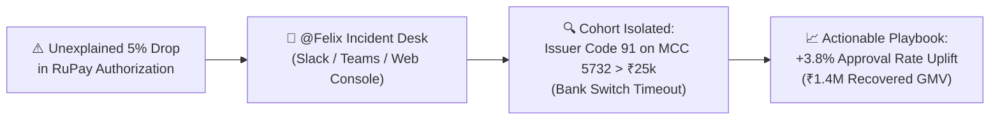
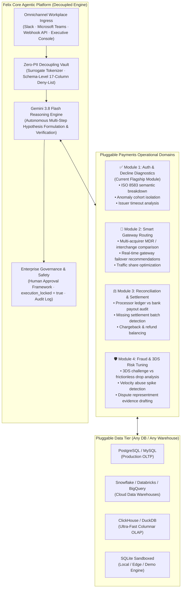

# Felix: Enterprise Autonomous Payments Agent Platform

<p align="center">
  
  
  
  
  
</p>

<p align="center">
  <a href="https://felix-payments-agent.onrender.com/"><b>🌐 Live Web App</b></a> &nbsp;&bull;&nbsp; 
  <a href="https://payments-team-central.slack.com/archives/C0CGRRPPD99"><b>💬 Slack Incident Desk</b></a>
</p>

<p align="center">
  <b>Felix is a modular, enterprise-grade autonomous AI payments agent that connects to any transaction database, orchestrates operational tools, and investigates and resolves complex payment authorization incidents across Slack, Microsoft Teams, and an Executive Web Console.</b>
</p>

---

## ⚡ Try It in 30 Seconds (Interactive Incident Scenarios)

Don't have time to read the full architecture? Test live multi-dimensional cohort isolation and GMV recovery right now:

👉 **[Launch Live Web Console](https://felix-payments-agent.onrender.com/)** &nbsp;or&nbsp; 👉 **[Jump into Slack `#payments-incidents`](https://payments-team-central.slack.com/archives/C0CGRRPPD99)**

Copy and paste any of these pre-built diagnostic prompts:

| Incident Scenario | Copy-Paste Diagnostic Prompt | Expected Agent Output |
| :--- | :--- | :--- |
| **🧪 Scenario A: The Issuer Switch Timeout** | `"@Felix why did our RuPay approval rate drop in the last 2 hours?"` | Isolates issuer response code 91 timeout spike on high-value electronics carts; calculates GMV impact. |
| **🧪 Scenario B: Multi-Dimensional Decline Drilldown** | `"@Felix break down recent declines by issuing bank, error code, and cart amount."` | Formulates deterministic SQL, surfaces top failure signatures, and isolates impacted merchant cohorts. |
| **🧪 Scenario C: Dynamic Routing Failover & ROI** | `"@Felix simulate gateway failover to Axis Bank and calculate recovered GMV."` | Models projected +3.8% authorization uplift, drafts remediation playbook with human approval lock (`execution_locked: true`). |

---

## 💡 The $100M Problem: Unexplained Authorization Bleed

In global digital commerce, payment authorization rates hover between 82% and 88%. A mere **1% drop in authorization represents $5,000,000+ in lost GMV** for a merchant or payment aggregator processing $500M annually, alongside wasted customer acquisition cost (CAC) and customer churn.

### The Operational Challenge:
* **Fragmented Payment Silos**: Decline data is scattered across card network switches (Visa, Mastercard, RuPay), issuing banks, payment aggregators, and 3D Secure ACS servers.
* **High Mean Time to Detect & Resolve (MTTD/MTTR)**: Operations and product teams spend 4+ hours writing ad-hoc SQL queries or waiting for data engineering tickets while revenue bleeds.
* **Context Fragmentation**: Triage discussions occur in **Slack** and **Microsoft Teams**, completely isolated from analytical data warehouses.
* **Generic AI Cannot Be Trusted**: Traditional LLMs hallucinate metrics, cannot formulate multi-step hypotheses on raw transaction ledgers, and present catastrophic data compliance risks if exposed to customer payment data (PCI-DSS).

### 📈 Product Economics & ROI Snapshot (Tier-1 Enterprise Merchant):
```
Annual Processing GMV:              $500,000,000
Cost of 1% Authorization Bleed:      $5,000,000 / year ($416,000 / month)
Status Quo Incident Triage MTTR:    4+ hours per anomaly (manual SQL & war rooms)
Felix Incident Triage MTTR:         < 60 seconds (autonomous hypothesis + sandboxed SQL)
Projected Authorization Recovery:   +2.0% to +3.8% across targeted merchant cohorts
Estimated Rescued GMV per Incident: ₹1,400,000+ ($17,000+) per isolated anomaly
```

---

## 🧠 Strategic Product Decisions (Why I Built It This Way as a PM)

Great products are defined by deliberate trade-offs and clear product principles. Here are the core product decisions behind Felix:

### 1. Ingress Decision: Workplace Chat (Slack & Teams) First, Web Console Second
* **The User Friction**: During a critical P1 payment drop, on-call SREs, Product Ops, and Merchant Managers assemble inside **Slack/Teams war rooms**. Forcing them to leave chat, log into a separate BI dashboard (Looker/Tableau), remember dimension filters, or write ad-hoc SQL introduces high cognitive load and wastes precious minutes.
* **The PM Decision**: Embed Felix natively where the triage already happens. Native Slack and MS Teams integration with threaded conversation memory lets the entire cross-functional team see the hypothesis, review the cohort breakdown, and debate remediation actions collaboratively in-channel without context switching.

### 2. Architecture Decision: 100% Deterministic SQL Grounding vs. End-to-End LLMs
* **The Trust Barrier**: Generic LLMs hallucinate numbers and statistical distributions. In fintech and payment operations, calculating a 4.2% decline rate when it is actually 1.8% destroys user credibility immediately.
* **The PM Decision**: Strictly separate **Reasoning** from **Calculation**. The LLM acts as the investigative planner (formulating hypotheses and choosing diagnostic tools), but 100% of numerical calculations, ratios, and distributions are executed via deterministic, sandboxed SQL against real ledgers. If data doesn't exist, Felix says so.

### 3. Safety Decision: The "Trust Layer" (Autonomous Diagnosis vs. Governed Execution)
* **The Risk Barrier**: Enterprise risk and compliance teams reject autonomous agents that can directly alter production routing or fire untested gateway switches without oversight.
* **The PM Decision**: Decouple **Diagnostic Autonomy** from **Execution Authority**. Felix has 100% autonomy to discover anomalies, isolate failure cohorts, and calculate financial impact. However, all remediation playbooks are output with `execution_locked: true`, requiring an authenticated human administrator to review and approve the action.

### 4. Compliance Decision: Zero-PII Sanitization Vault (PCI-DSS by Design)
* **The Compliance Barrier**: Payment ledgers contain Primary Account Numbers (PANs), cardholder names, and CVVs. Sending this data to external AI models is an immediate regulatory violation.
* **The PM Decision**: Enforce a 17-column schema deny-list and surrogate tokenization vault before prompt synthesis. Sensitive cardholder credentials never enter LLM context memory or external network payloads.

---

## 👥 Target Personas & Jobs-To-Be-Done (JTBD)

Felix was built around the distinct daily workflows of cross-functional fintech stakeholders:

| Persona | Role & Context | Core Job-To-Be-Done (JTBD) | Felix Solution |
| :--- | :--- | :--- | :--- |
| **On-Call Payment SRE** | Technical Incident Responder | *"When an auth alert fires at 2 AM, I need to isolate whether it's a gateway switch timeout or bank ACS failure in <2 minutes without writing raw queries."* | Instant cohort isolation via `@Felix` in Slack with deterministic SQL breakdown and bank latency benchmarks. |
| **Payment Product Operations** | Revenue & Route Optimization | *"I need to identify which merchant categories or card rails are underperforming our baseline and model the GMV recovery of re-routing traffic."* | Automated GMV uplift modeling and routing failover simulation playbooks. |
| **Enterprise Merchant Success** | Strategic Account Management | *"When an enterprise merchant complains about checkout dropoffs, I need an evidence-backed diagnostic report with exact failure codes within 5 minutes."* | Instant incident root-cause attribution summaries ready for merchant-facing debriefs. |
| **Fintech Risk & Compliance** | Data Security & Governance | *"I must guarantee that internal AI tooling complies with PCI-DSS and will never execute unsanctioned production mutations."* | Zero-PII decoupling vault + human approval locks on all remediation playbooks. |

---

## 📊 Product Metrics & Evaluation Framework

To measure product efficacy and operational excellence, Felix is tracked against strict North Star and Guardrail metrics:



---

## ⚡ The Solution: How Felix Solves It

Whenever an authorization anomaly or payment event occurs, team members simply ask inside their existing chat tools:
> *"@Felix, why did our RuPay approval rate drop in the last 2 hours?"*

Felix autonomously:
1. **Formulates Diagnostic Hypotheses**: Evaluates network baselines, bank health, response code distributions, and channel latencies.
2. **Executes 100% Deterministic SQL**: Runs sandboxed, read-only analytical queries against your transaction data.
3. **Isolates Multi-Dimensional Cohorts**: Detects the exact failure signature (e.g., *RuPay + MCC 5732 Electronics + Cart Amount > ₹25,000 + Issuer Response Code 91*).
4. **Calculates Financial Impact**: Estimates recovered GMV uplift (e.g., *+3.8% approval uplift = ₹1.4M recovered GMV*).
5. **Drafts Actionable Playbooks**: Generates prioritized remediation actions with suggested owners and routing adjustments.



---

## 🏆 Competitive Advantage: Felix vs. The Market

| Dimension | Traditional BI (Tableau / Looker) | Generic Chatbots (ChatGPT / Copilot) | Felix Enterprise Platform |
| :--- | :--- | :--- | :--- |
| **Diagnostic Model** | **Passive**: Renders charts; humans must manually slice and dice | **Text-only**: Generic answers; no live data grounding | **Autonomous Agentic**: Formulates hypotheses, executes queries, isolates cohorts |
| **Numerical Accuracy** | 100% (SQL-based) | **Prone to Hallucinations**: Guesses percentages and statistics | **100% Deterministic**: Grounded directly in live transaction records |
| **Data Privacy** | Internal DB access | **High Risk**: Cardholder data sent to external cloud LLMs | **Zero-PII Decoupling Vault**: Card numbers & PII never leave enterprise memory |
| **Workplace Ingress** | Siloed dashboard URL | Browser tab silo | **Native Slack & Microsoft Teams** with threaded multi-turn memory |
| **Operational Safety** | Read-only viewing | Unpredictable SQL generation | **Engine Immutability Triggers + Permanent Human Approval Lock** |

---

## 🔌 Decoupled by Design: Any Database, Any Tool, Any Purpose

Felix's architectural superpower is its **radical modular decoupling**:

### 1. Database-Agnostic Analytical Engine
Felix's reasoning core does not care where your payment transactions live. The SQL executor communicates via modular database connection providers:
* **Embedded & Local Testing**: SQLite with query-only sandboxing (`PRAGMA query_only = ON;`).
* **Transactional Production OLTP**: Direct read-only replicas of **PostgreSQL**, **MySQL**, or **Amazon Aurora**.
* **Enterprise Cloud Data Warehouses**: Standard connectors for **Snowflake**, **Google BigQuery**, **Databricks**, and **Amazon Redshift**.
* **Ultra-Fast Streaming OLAP**: Native compatibility with columnar engines like **ClickHouse** and **DuckDB** for querying 100M+ transactions in $<50\text{ms}$.

### 2. Extensible Tool Calling Registry
Tools in Felix are modular Python functions registered into the Google Gen AI function-calling schema:
```python
@register_tool
def simulate_routing_failover(acquirer_from: str, acquirer_to: str, volume_pct: float):
    """Simulate projected authorization lift and cost impact of shifting traffic."""
    ...
```
You can effortlessly plug in:
* **Operational Actions**: PagerDuty incident triggers, Jira ticket creators, or Slack alert broadcasters.
* **Payment Gateways**: Live status check APIs for Stripe, Adyen, Checkout.com, or Razorpay.
* **Risk & Fraud Scorecards**: Real-time fraud velocity tools and chargeback representment builders.

### 3. Purpose-Agnostic Reasoning Engine
The core orchestration engine handles context management, event deduplication, token scrubbers, and role-based permissions independently of the business logic. Switching Felix from analyzing **decline spikes** to **settlement discrepancies** or **foreign exchange (FX) margin leakages** requires zero changes to the messaging layer or security architecture.

---

## 🛡️ Enterprise Security, Privacy & Safety Invariants

1. **Zero-PII Decoupling Vault**:
   - Customer Primary Account Numbers (PANs), cardholder names, CVVs, and passwords are intercepted before prompts reach the LLM.
   - The SQL execution engine enforces a 17-column deny-list that blocks any query referencing sensitive credentials.
2. **Read-Only Agent Safety**:
   - Destructive keywords (`DROP`, `DELETE`, `UPDATE`, `INSERT`, `ALTER`, `PRAGMA`) are rejected at the compiler level.
   - Database immutability triggers prevent table alterations.
3. **Role-Based Access Control (RBAC)**:
   - Built-in permission barriers distinguish between **Standard Users** (can query Felix) and **Organisation Administrators** (can configure credentials and toggle integrations).
4. **Human Approval Framework (Safe by Design)**:
   - Felix can recommend routing adjustments, merchant alerts, and failover switches, but **cannot directly alter production infrastructure**.
   - All proposed actions are saved with `execution_locked: true` and require human administrator review.
5. **Immutable Security Audit Log**:
   - Every inbound query, caller role, execution latency, and admin modification is logged to `security_audit_logs` with automatic secret scrubbing (`[REDACTED_SECURITY_SECRET]`).

---

## 🌐 Live Interactive Demo & Testing

Experience Felix live in production through the executive web console or directly inside Slack:

### Option A: Live Web Console
* **🔗 Live App URL**: [https://felix-payments-agent.onrender.com/](https://felix-payments-agent.onrender.com/)
* Explore live Chart.js visualizations, run autonomous decline investigations, test multi-model failover (Gemini / ChatGPT / Local SQL), inspect real-time logs, and access the Enterprise Integrations admin panel.

### Option B: Test Felix Live in Slack
Want to test how Felix operates in a real workplace environment?
1. **Open the Slack Incident Channel**: [👉 Open `#payments-incidents` in Slack](https://payments-team-central.slack.com/archives/C0CGRRPPD99)
2. Jump into the channel.
3. Mention `@Felix` and ask any payment authorization or decline question:
   - `@Felix why did our approval rate drop?`
   - `@Felix break down the recent declines by issuing bank.`
   - `@Felix recommend an action to recover lost GMV.`

---

## 🚀 Quickstart: Run Locally in 60 Seconds

### Option 1: Docker (Recommended)

```bash
# Clone the repository
git clone https://github.com/piyush07rai/felix-payments-agent.git
cd felix-payments-agent

# Build and start container
docker compose up --build
```

Open [http://localhost:8000](http://localhost:8000) in your browser.

---

### Option 2: Local Python Environment

```bash
# 1. Create and activate virtual environment
python3 -m venv venv
source venv/bin/activate

# 2. Install dependencies
pip install -r requirements.txt

# 3. Configure environment
cp .env.example .env
# (Optional) Add your GEMINI_API_KEY from https://aistudio.google.com/
# Felix works completely offline via its deterministic fallback engine if no key is provided!

# 4. Launch the application
uvicorn app.main:app --host 0.0.0.0 --port 8000 --reload
```

---

## 🎯 Platform Vision: Beyond a Single Analyst

While traditional tools are built as rigid, single-purpose dashboards, **Felix is an extensible Agentic Payments Operating System**. 

It uses a **Land-and-Expand Product Architecture**:
* **Flagship Module (The High-ROI Wedge)**: *Autonomous Payment Authorization & Decline Intelligence*. Resolves the multi-million-dollar hair-on-fire problem of unexplained authorization drops in seconds.
* **Extensible Agentic Core**: The exact same conversational ingress, Zero-PII sanitization vault, reasoning loop, and human governance framework power multiple operational domains across **any payment rail** (Cards, UPI, A2A, Pix, FedNow, Wallets, and BNPL).



---

## 📜 License

Distributed under the Apache 2.0 License. Designed for payments innovation, operational excellence, and agentic AI leadership.
