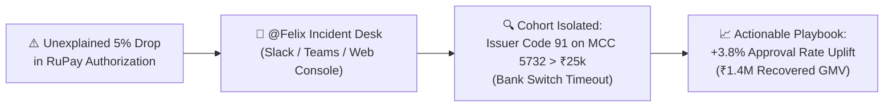

# Felix: Enterprise AI Payments Decline Analyst

<p align="center">
  
  
  
  
</p>

<p align="center">
  <b>An autonomous AI payment operations analyst that detects authorization drops, isolates multi-dimensional cohorts, and generates actionable remediation playbooks in seconds—accessible across Slack, Microsoft Teams, and an Executive Web Console.</b>
</p>

---

## 💡 The Problem: The $100M Silent Revenue Leak

In enterprise digital commerce, global card authorization rates hover between 82% and 88%. Every 1% drop in authorization represents **$5,000,000+ in unrecovered GMV** for a high-volume merchant or payment aggregator, alongside wasted customer acquisition cost (CAC) and customer churn.

### The Operational Challenge:
* **Fragmented Payment Silos**: Decline data is scattered across card network switches (Visa, Mastercard, RuPay), issuing banks, payment aggregators, and 3D Secure ACS servers.
* **High Mean Time to Detect & Resolve (MTTD/MTTR)**: Operations and product teams spend 4+ hours running ad-hoc SQL queries or waiting for data engineering sprints while revenue leaks.
* **Context Fragmentation**: Triage discussions occur in **Slack** and **Microsoft Teams**, completely isolated from analytical data warehouses.
* **Generic AI Cannot Be Trusted**: Traditional LLMs hallucinate metrics, cannot formulate multi-step hypotheses on raw transaction ledgers, and present catastrophic data compliance risks if exposed to customer payment data (PCI-DSS).

---

## ⚡ The Solution: Meet Felix

**Felix** is an autonomous AI agent engineered specifically for payments product managers and incident operations teams. 

Whenever an authorization anomaly occurs, team members simply ask inside their existing chat tools:
> *"@Felix, why did our RuPay approval rate drop in the last 2 hours?"*

Felix autonomously:
1. **Formulates Diagnostic Hypotheses**: Evaluates network baselines, bank health, response code distributions, and channel latencies.
2. **Executes 100% Deterministic SQL**: Runs sandboxed, read-only analytical queries against your transaction data.
3. **Isolates Multi-Dimensional Cohorts**: Detects the exact failure signature (e.g., *RuPay + MCC 5732 Electronics + Cart Amount > ₹25,000 + Issuer Response Code 91*).
4. **Calculates Financial Impact**: Estimates recovered GMV uplift (e.g., *+3.8% approval uplift = ₹1.4M recovered GMV*).
5. **Drafts Actionable Playbooks**: Generates prioritized remediation actions with suggested owners and routing adjustments.



---

## 🏆 Competitive Advantage: Felix vs. The Market

| Dimension | Traditional BI (Tableau / Looker) | Generic Chatbots (ChatGPT / Copilot) | Felix Enterprise Analyst |
| :--- | :--- | :--- | :--- |
| **Diagnostic Model** | **Passive**: Renders charts; humans must manually slice and dice | **Text-only**: Generic answers; no live data grounding | **Autonomous Agentic**: Formulates hypotheses, executes queries, isolates cohorts |
| **Numerical Accuracy** | 100% (SQL-based) | **Prone to Hallucinations**: Guesses percentages and statistics | **100% Deterministic**: Grounded directly in live transaction records |
| **Data Privacy** | Internal DB access | **High Risk**: Cardholder data sent to external cloud LLMs | **Zero-PII Decoupling Vault**: Card numbers & PII never leave enterprise memory |
| **Workplace Ingress** | Siloed dashboard URL | Browser tab silo | **Native Slack & Microsoft Teams** with threaded multi-turn memory |
| **Operational Safety** | Read-only viewing | Unpredictable SQL generation | **Engine Immutability Triggers + Permanent Human Approval Lock** |

---

## 🏗️ Architecture: Decoupled & Modular Design

Felix is built with strict architectural decoupling across three tiers: **Messaging Ingress**, **Agentic Reasoning**, and **Data Storage**.

```text
┌────────────────────────────────────────────────────────────────────────┐
│                        Enterprise Messaging Ingress                    │
│   [Slack @Felix app_mention]    [MS Teams @Felix]    [Web Dashboard]   │
└────────────────────────────────────┬───────────────────────────────────┘
                                     │
┌────────────────────────────────────▼───────────────────────────────────┐
│                      Zero-PII Decoupling Vault                         │
│  • Surrogate Tokenizer: Scrubs PANs, CVVs, Emails, and Names           │
│  • Schema-Level Deny-List: Blocks 17 sensitive columns at compiler     │
│  • Local Rehydration Vault: Restores business context safely on host   │
└────────────────────────────────────┬───────────────────────────────────┘
                                     │ Clean Scrubber Query
┌────────────────────────────────────▼───────────────────────────────────┐
│                   Common Enterprise Integration Layer                  │
│  • Unified CommonMessageRequest & Response Schemas                     │
│  • Multi-Tenant Session Isolation (platform:org:channel:thread)        │
│  • Asynchronous Background Worker with Event Deduplication             │
└────────────────────────────────────┬───────────────────────────────────┘
                                     │
┌────────────────────────────────────▼───────────────────────────────────┐
│                   Pluggable Agentic Reasoning Core                     │
│  • Powered by Google Gemini 3.8 Flash (google-genai function calling)  │
│  • Autonomous Offline Fallback (Deterministic rule-based engine)       │
│  • Sandboxed Analytical Tool Registry:                                 │
│    ├── run_sql (Read-Only SELECT / WITH, capped at 500 rows, 5s timeout)
│    ├── get_baseline (Dimensional variance against historical baselines)│
│    ├── lookup_response_code (ISO 8583 semantic meaning & responsible party)
│    └── draft_action (Structured playbook synthesis; execution locked)  │
└───────────────────┬────────────────────────────────┬───────────────────┘
                    │                                │
┌───────────────────▼──────────────┐   ┌─────────────▼───────────────────┐
│     Pluggable Database Tier      │   │     Human Approval Framework    │
│  Compatible with:                │   │  • execution_locked = true      │
│  PostgreSQL · Snowflake ·        │   │  • Advisory only                │
│  ClickHouse · BigQuery · SQLite  │   │  • Admin sign-off required      │
└──────────────────────────────────┘   └─────────────────────────────────┘
```

### 1. Pluggable on Top of Any Database
The agentic layer does not depend on SQLite. Analytical queries pass through standardized SQL interfaces:
* **Current Default**: High-performance SQLite with query-only sandboxing (`PRAGMA query_only = ON;`).
* **Enterprise Adapters**: Easily connects to **PostgreSQL**, **Snowflake**, **Google BigQuery**, or **ClickHouse** by updating the database connection provider.

### 2. Extensible Tool Registry
Analytical tools are modular Python functions. Want to add a PagerDuty alerting tool, an automated Jira ticket generator, or an Adyen/Stripe routing switch? Register them into `app/tools.py` with zero changes to the underlying agent brain.

### 3. Omnichannel Ingress (Single Brain, Strict Isolation)
* **Slack App**: Supports `@Felix` channel mentions, threaded discussions, and rich Slack Block Kit responses.
* **Microsoft Teams Bot**: Integrated via Bot Framework REST Connector and Adaptive Cards 1.5.
* **Zero Data Leakage**: Inquiries across Slack, Teams, and Web maintain strict thread-level session isolation (`platform:org:channel:thread`). Chats in Slack never leak into Teams.

---

## 🛡️ Enterprise Security, Governance & Safety

1. **Zero-PII Decoupling Vault**:
   - Customer Primary Account Numbers (PANs), cardholder names, CVVs, and passwords are intercepted before prompts reach the LLM.
   - The SQL execution engine enforces a 17-column deny-list that blocks any query referencing sensitive credentials.
2. **Read-Only Agent Safety**:
   - Destructive keywords (`DROP`, `DELETE`, `UPDATE`, `INSERT`, `ALTER`, `PRAGMA`) are rejected at the compiler level.
   - Database immutability triggers prevent table alterations.
3. **Role-Based Access Control (RBAC)**:
   - Built-in permission barriers distinguish between **Standard Users** (can query Felix) and **Organisation Administrators** (can configure credentials and toggle integrations).
4. **Human Approval Framework (Safe by Design)**:
   - Felix can recommend routing adjustments, merchant alerts, and failover switches, but **cannot directly alter production infrastructure**.
   - All proposed actions are saved with `execution_locked: true` and require human administrator review.
5. **Immutable Security Audit Log**:
   - Every inbound query, caller role, execution latency, and admin modification is logged to `security_audit_logs` with automatic secret scrubbing (`[REDACTED_SECURITY_SECRET]`).

---

## 🚀 Quickstart: Run in 60 Seconds

### Option 1: Docker (Recommended)

```bash
# Clone the repository
git clone https://github.com/piyush07rai/felix-payments-agent.git
cd felix-payments-agent

# Build and start container
docker compose up --build
```

Open [http://localhost:8000](http://localhost:8000) in your browser.

---

### Option 2: Local Python Environment

```bash
# 1. Create and activate virtual environment
python3 -m venv venv
source venv/bin/activate

# 2. Install dependencies
pip install -r requirements.txt

# 3. Configure environment
cp .env.example .env
# (Optional) Add your GEMINI_API_KEY from https://aistudio.google.com/
# Felix works completely offline via its deterministic fallback engine if no key is provided!

# 4. Launch the application
uvicorn app.main:app --host 0.0.0.0 --port 8000 --reload
```

---

## 📊 Live Interactive Demo Walkthrough

Once the application is running, open [http://localhost:8000](http://localhost:8000):

1. **Auto-Populated Dataset**: Felix automatically initializes and seeds 5,000 realistic transactions on initial startup.
2. **Overview Tab**: Inspect live Chart.js visualizations (Approval Rate, Response Code Breakdown, Network Distribution, Hourly Volume).
3. **AI Investigation Tab**:
   - Click one of the quick prompts (e.g., *"Why did RuPay authorization drop?"*).
   - Watch the live **Agent Execution Events** stream: SQL queries executed, ISO 8583 lookups, and baseline comparisons.
4. **Findings Tab**: Review the structured remediation playbook, estimated approval uplift (+3.8%), and the **Human Approval Governance Card**.
5. **Enterprise Integrations Tab**:
   - View live Slack and Microsoft Teams connector status cards.
   - Inspect the **Integration Activity Audit Trail** with real-time platform and status filters.
   - Switch between **Standard User** and **Organisation Administrator** to see RBAC permissions in action.
6. **Evaluation Benchmark**:
   - Run quantitative accuracy, precision, and recall evaluations against isolated ground-truth benchmarks.

---

## 🧪 Comprehensive Test Suite

Felix comes with **30 enterprise unit tests** validating all security layers, integrations, and tools:

```bash
python3 -m unittest discover tests -v
```

```text
Ran 30 tests in 0.285s
OK
```

---

## ☁️ Free Production Deployment (Render)

Deploy your own live instance of Felix for free on [Render](https://render.com):

1. **Fork or Push** this repository to your GitHub account.
2. Sign in to [Render](https://render.com) and click **New + > Web Service**.
3. Select your repository: `felix-payments-agent`.
4. Configure:
   - **Environment**: `Docker`
   - **Plan**: `Free`
5. Under **Environment Variables**, add:
   - `GEMINI_API_KEY`: Your key from Google AI Studio.
   - `APP_ENV`: `production`
6. Click **Deploy Web Service**. Render builds the container and provides a free public HTTPS endpoint (e.g., `https://felix-payments-agent.onrender.com`).
7. Use this HTTPS URL to register Slack webhooks (`/api/slack/events`) or Teams messaging endpoints (`/api/teams/messages`).

---

## 📚 Technical Documentation & Strategy Dossiers

* 📄 **[Executive Product Presentation & Business Dossier](file:///Users/piyushrai/.gemini/antigravity/brain/89e26ea4-565d-482c-ac21-b434045ba1d2/felix_product_presentation.md)**: Full 8-slide PM presentation deck, ROI calculations ($2.5M uplift per $500M GMV), and competitive moat.
* 🔒 **[Enterprise Security & Access Control Architecture](file:///Users/piyushrai/.gemini/antigravity/brain/89e26ea4-565d-482c-ac21-b434045ba1d2/enterprise_security_architecture.md)**: Cryptographic signature verification, RBAC matrix, and audit compliance details.

---

## 📜 License

Distributed under the Apache 2.0 License. Designed for payments innovation, operational excellence, and agentic AI leadership.
