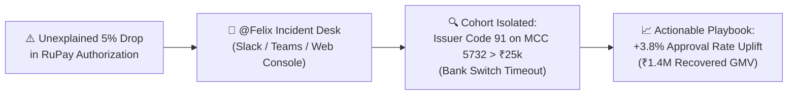
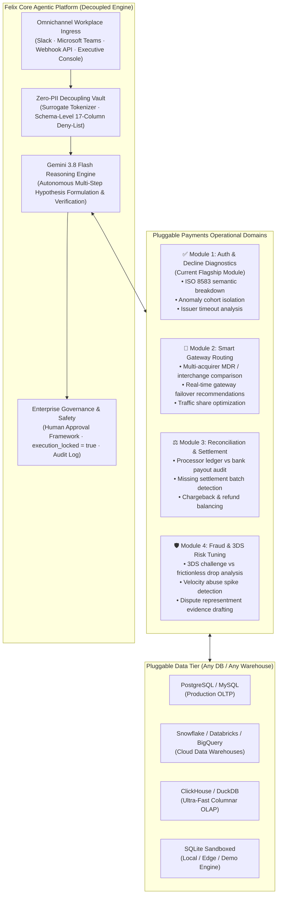

# Felix: Enterprise Autonomous Payments Agent Platform

<p align="center">
  
  
  
  
  
</p>

<p align="center">
  <a href="https://felix-payments-agent.onrender.com/"><b>🌐 Live Web App</b></a> &nbsp;&bull;&nbsp; 
  <a href="https://payments-team-central.slack.com/archives/C0CGRRPPD99"><b>💬 Slack Incident Desk</b></a>
</p>

<p align="center">
  <b>Felix is a modular, enterprise-grade autonomous AI payments agent that connects to any database, orchestrates operational tools, and investigates and resolves complex payment incidents across Slack, Microsoft Teams, and an Executive Web Console.</b>
</p>

---

## 💡 The $100M Problem: Unexplained Authorization Bleed

In global digital commerce, payment authorization rates hover between 82% and 88%. A mere **1% drop in authorization represents $5,000,000+ in lost GMV** for a merchant or payment aggregator processing $500M annually, alongside wasted customer acquisition cost (CAC) and customer churn.

### The Operational Challenge:
* **Fragmented Payment Silos**: Decline data is scattered across card network switches (Visa, Mastercard, RuPay), issuing banks, payment aggregators, and 3D Secure ACS servers.
* **High Mean Time to Detect & Resolve (MTTD/MTTR)**: Operations and product teams spend 4+ hours writing ad-hoc queries or waiting for data engineering tickets while revenue bleeds.
* **Context Fragmentation**: Triage discussions occur in **Slack** and **Microsoft Teams**, completely isolated from analytical data warehouses.
* **Generic AI Cannot Be Trusted**: Traditional LLMs hallucinate metrics, cannot formulate multi-step hypotheses on raw transaction ledgers, and present catastrophic data compliance risks if exposed to customer payment data (PCI-DSS).

---

## ⚡ The Solution: How Felix Solves It

Whenever an authorization anomaly or payment event occurs, team members simply ask inside their existing chat tools:
> *"@Felix, why did our RuPay approval rate drop in the last 2 hours?"*

Felix autonomously:
1. **Formulates Diagnostic Hypotheses**: Evaluates network baselines, bank health, response code distributions, and channel latencies.
2. **Executes 100% Deterministic SQL**: Runs sandboxed, read-only analytical queries against your transaction data.
3. **Isolates Multi-Dimensional Cohorts**: Detects the exact failure signature (e.g., *RuPay + MCC 5732 Electronics + Cart Amount > ₹25,000 + Issuer Response Code 91*).
4. **Calculates Financial Impact**: Estimates recovered GMV uplift (e.g., *+3.8% approval uplift = ₹1.4M recovered GMV*).
5. **Drafts Actionable Playbooks**: Generates prioritized remediation actions with suggested owners and routing adjustments.



---

## 🏆 Competitive Advantage: Felix vs. The Market

| Dimension | Traditional BI (Tableau / Looker) | Generic Chatbots (ChatGPT / Copilot) | Felix Enterprise Platform |
| :--- | :--- | :--- | :--- |
| **Diagnostic Model** | **Passive**: Renders charts; humans must manually slice and dice | **Text-only**: Generic answers; no live data grounding | **Autonomous Agentic**: Formulates hypotheses, executes queries, isolates cohorts |
| **Numerical Accuracy** | 100% (SQL-based) | **Prone to Hallucinations**: Guesses percentages and statistics | **100% Deterministic**: Grounded directly in live transaction records |
| **Data Privacy** | Internal DB access | **High Risk**: Cardholder data sent to external cloud LLMs | **Zero-PII Decoupling Vault**: Card numbers & PII never leave enterprise memory |
| **Workplace Ingress** | Siloed dashboard URL | Browser tab silo | **Native Slack & Microsoft Teams** with threaded multi-turn memory |
| **Operational Safety** | Read-only viewing | Unpredictable SQL generation | **Engine Immutability Triggers + Permanent Human Approval Lock** |

---

## 🔌 Decoupled by Design: Any Database, Any Tool, Any Purpose

Felix's true superpower is its **radical architectural decoupling**:

### 1. Database-Agnostic Analytical Engine
Felix's reasoning core does not care where your payment transactions live. The SQL executor communicates via modular database connection providers:
* **Embedded & Local Testing**: SQLite with query-only sandboxing (`PRAGMA query_only = ON;`).
* **Transactional Production OLTP**: Direct read-only replicas of **PostgreSQL**, **MySQL**, or **Amazon Aurora**.
* **Enterprise Cloud Data Warehouses**: Standard connectors for **Snowflake**, **Google BigQuery**, **Databricks**, and **Amazon Redshift**.
* **Ultra-Fast Streaming OLAP**: Native compatibility with columnar engines like **ClickHouse** and **DuckDB** for querying 100M+ transactions in $<50\text{ms}$.

### 2. Extensible Tool Calling Registry
Tools in Felix are modular Python functions registered into the Google Gen AI function-calling schema:
```python
@register_tool
def simulate_routing_failover(acquirer_from: str, acquirer_to: str, volume_pct: float):
    """Simulate projected authorization lift and cost impact of shifting traffic."""
    ...
```
You can effortlessly plug in:
* **Operational Actions**: PagerDuty incident triggers, Jira ticket creators, or Slack alert broadcasters.
* **Payment Gateways**: Live status check APIs for Stripe, Adyen, Checkout.com, or Razorpay.
* **Risk & Fraud Scorecards**: Real-time fraud velocity tools and chargeback representment builders.

### 3. Purpose-Agnostic Reasoning Engine
The core orchestration engine handles context management, event deduplication, token scrubbers, and role-based permissions independently of the business logic. Switching Felix from analyzing **decline spikes** to **settlement discrepancies** or **foreign exchange (FX) margin leakages** requires zero changes to the messaging layer or security architecture.

---

## 🛡️ Enterprise Security, Privacy & Safety Invariants

1. **Zero-PII Decoupling Vault**:
   - Customer Primary Account Numbers (PANs), cardholder names, CVVs, and passwords are intercepted before prompts reach the LLM.
   - The SQL execution engine enforces a 17-column deny-list that blocks any query referencing sensitive credentials.
2. **Read-Only Agent Safety**:
   - Destructive keywords (`DROP`, `DELETE`, `UPDATE`, `INSERT`, `ALTER`, `PRAGMA`) are rejected at the compiler level.
   - Database immutability triggers prevent table alterations.
3. **Role-Based Access Control (RBAC)**:
   - Built-in permission barriers distinguish between **Standard Users** (can query Felix) and **Organisation Administrators** (can configure credentials and toggle integrations).
4. **Human Approval Framework (Safe by Design)**:
   - Felix can recommend routing adjustments, merchant alerts, and failover switches, but **cannot directly alter production infrastructure**.
   - All proposed actions are saved with `execution_locked: true` and require human administrator review.
5. **Immutable Security Audit Log**:
   - Every inbound query, caller role, execution latency, and admin modification is logged to `security_audit_logs` with automatic secret scrubbing (`[REDACTED_SECURITY_SECRET]`).

---

## 🌐 Live Interactive Demo & Testing

Experience Felix live in production through the executive web console or directly inside Slack:

### Option A: Live Web Console
* **🔗 Live App URL**: [https://felix-payments-agent.onrender.com/](https://felix-payments-agent.onrender.com/)
* Explore live Chart.js visualizations, run autonomous decline investigations, test multi-model failover (Gemini / ChatGPT / Local SQL), inspect real-time logs, and access the Enterprise Integrations admin panel.

### Option B: Test Felix Live in Slack
Want to test how Felix operates in a real workplace environment?
1. **Open the Slack Incident Channel**: [👉 Open `#payments-incidents` in Slack](https://payments-team-central.slack.com/archives/C0CGRRPPD99)
2. Jump into the channel.
3. Mention `@Felix` and ask any payment authorization or decline question:
   - `@Felix why did our approval rate drop?`
   - `@Felix break down the recent declines by issuing bank.`
   - `@Felix recommend an action to recover lost GMV.`

---

## 🚀 Quickstart: Run Locally in 60 Seconds

### Option 1: Docker (Recommended)

```bash
# Clone the repository
git clone https://github.com/piyush07rai/felix-payments-agent.git
cd felix-payments-agent

# Build and start container
docker compose up --build
```

Open [http://localhost:8000](http://localhost:8000) in your browser.

---

### Option 2: Local Python Environment

```bash
# 1. Create and activate virtual environment
python3 -m venv venv
source venv/bin/activate

# 2. Install dependencies
pip install -r requirements.txt

# 3. Configure environment
cp .env.example .env
# (Optional) Add your GEMINI_API_KEY from https://aistudio.google.com/
# Felix works completely offline via its deterministic fallback engine if no key is provided!

# 4. Launch the application
uvicorn app.main:app --host 0.0.0.0 --port 8000 --reload
```

---

## 🎯 Platform Vision: Beyond a Single Analyst

While traditional tools are built as rigid, single-purpose dashboards, **Felix is an extensible Agentic Payments Operating System**. 

It uses a **Land-and-Expand Product Architecture**:
* **Flagship Module (The High-ROI Wedge)**: *Autonomous Payment Authorization & Decline Intelligence*. Resolves the multi-million-dollar hair-on-fire problem of unexplained authorization drops in seconds.
* **Extensible Agentic Core**: The exact same conversational ingress, Zero-PII sanitization vault, reasoning loop, and human governance framework power multiple operational domains across **any payment rail** (Cards, UPI, A2A, Pix, FedNow, Wallets, and BNPL).



---

## 📜 License

Distributed under the Apache 2.0 License. Designed for payments innovation, operational excellence, and agentic AI leadership.
