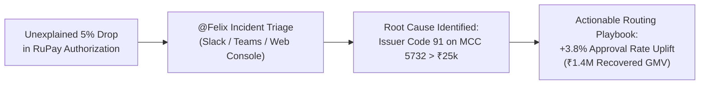

# Felix: Enterprise AI Payments Decline Analyst

[](https://fastapi.tiangolo.com)
[](https://aistudio.google.com)
[](https://api.slack.com)
[](https://dev.teams.microsoft.com)
[](file:///app/privacy.py)
[](tests/)

An enterprise-grade autonomous AI assistant and Product Manager portfolio project that investigates payment authorization drops, isolates root causes across multi-dimensional cohorts, and drafts actionable merchant/issuer remediation playbooks—grounded in **100% deterministic SQL analytics** and accessible across **Slack**, **Microsoft Teams**, and a dedicated **Executive Web Console**.

---

## 1. Executive Summary & Problem Space

In global digital commerce, a **1% to 2% drop in payment authorization rates** leaks millions of dollars in lost GMV, wasted customer acquisition cost (CAC), and cart abandonment. 

Investigating payment declines is notoriously difficult:
- **Fragmented Data**: Distributed across acquirer switches, issuer networks (Visa, Mastercard, RuPay), 3D Secure gateways, and merchant accounting.
- **High Mean Time to Detect & Resolve (MTTD/MTTR)**: Operations teams spend hours running ad-hoc SQL queries or waiting for data engineering tickets while revenue bleeds.
- **Context Fragmentation**: Incident triage happens in **Slack** and **Microsoft Teams**, isolated from raw analytical databases.

### Enter Felix
**Felix** acts as an autonomous 24/7 payment operations analyst. When an engineer or PM asks:
> *"@Felix, why has our RuPay approval rate dropped in the last 2 hours?"*

Felix autonomously formulates hypotheses, executes read-only SQL queries across payment dimensions, cross-references historical baselines, and returns root-cause breakdowns with remediation playbooks in seconds—**without exposing card numbers, CVVs, or customer PII to external LLMs**.



---

## 2. Omnichannel Architecture

Felix is powered by a **single underlying agent brain** decoupled from presentation channels through a **Common Enterprise Integration Layer**:

```text
┌────────────────────────────────────────────────────────────────────────┐
│                        Enterprise Messaging Ingress                    │
│   [Slack @Felix app_mention]    [MS Teams @Felix]    [Web Dashboard]   │
└────────────────────────────────────┬───────────────────────────────────┘
                                     │
┌────────────────────────────────────▼───────────────────────────────────┐
│                      Zero-PII Decoupling Vault                         │
│  - Surrogate Tokenizer (Scrubs PANs, CVVs, Emails, Names)              │
│  - Schema Deny-List (Rejects 17 sensitive columns at SQL compiler)     │
│  - Local Rehydration Vault (Restores business context locally)         │
└────────────────────────────────────┬───────────────────────────────────┘
                                     │ Clean Scrubber Query
┌────────────────────────────────────▼───────────────────────────────────┐
│                   Common Enterprise Integration Layer                  │
│  - CommonMessageRequest & CommonMessageResponse Schemas                │
│  - Multi-Tenant Session Isolation (platform:workspace:channel:thread)  │
│  - Asynchronous CommonMessageProcessor with Background Worker          │
└────────────────────────────────────┬───────────────────────────────────┘
                                     │
┌────────────────────────────────────▼───────────────────────────────────┐
│                     Felix Core Reasoning Engine                        │
│  - Google Gemini 3.8 Flash (google-genai native function calling)      │
│  - Deterministic Offline Fallback (Rule-based diagnostic engine)       │
│  - Permitted Sandboxed Tools:                                          │
│    * run_sql (Read-Only SELECT / WITH, capped at 500 rows, 5s timeout) │
│    * get_baseline (Dimensional variance against historical baselines)  │
│    * lookup_response_code (ISO 8583 semantic meaning & party mapping)  │
│    * draft_action (Synthesizes advisory playbooks; execution locked)   │
└───────────────────┬────────────────────────────────┬───────────────────┘
                    │                                │
┌───────────────────▼──────────────┐   ┌─────────────▼───────────────────┐
│   SQLite Database (declines.db)  │   │     Human Approval Framework    │
│  - PRAGMA query_only = ON        │   │  - execution_locked = true      │
│  - Immutability database triggers│   │  - Pending Administrator Review │
└──────────────────────────────────┘   └─────────────────────────────────┘
```

---

## 3. Key Differentiators & PM Moat

| Feature | Generic Chatbots (ChatGPT / Copilot) | Felix Payments Analyst |
| :--- | :--- | :--- |
| **Numerical Accuracy** | Hallucinates statistics and averages | **100% Deterministic SQL Grounding** (all numbers computed directly on transactions) |
| **Data Privacy** | Raw customer data sent to cloud models | **Zero-PII Decoupling Vault** (PANs and secrets never leave host memory) |
| **Workplace Ingress** | Isolated browser tab | **Native Slack & Teams Bots** with threaded multi-turn contextual memory |
| **Agent Safety** | Vulnerable to prompt injection SQL writes | **Engine Immutability Triggers + PRAGMA query_only = ON** blocking all modifications |
| **Operational Control** | Can trigger unintended infrastructure edits | **Human Approval Framework** (production execution permanently locked) |

---

## 4. Features & Capabilities

### A. Omnichannel Workplace Integration
- **Slack App (`@Felix`)**: Mention Felix in any channel or thread. Felix acknowledges immediately, analyzes data asynchronously, and returns rich Slack Block Kit responses with metric callouts.
- **Microsoft Teams (`@Felix`)**: Integrated via Microsoft Bot Framework Connector and Adaptive Cards 1.5. Supports threaded multi-turn follow-up questions.
- **Enterprise Integrations Dashboard**: Administrative console to monitor connection health, view live activity logs, and configure Slack/Teams tokens with write-only masking.

### B. Enterprise Security & Access Control (RBAC)
- **Role-Based Access Control**: Distinguishes between `Organisation Administrator` and `Standard User`. Administrative settings and listener toggles are protected with `403 Forbidden` checks.
- **Zero-PII Decoupling**: Surrogate tokenization masks sensitive card credentials before the prompt touches the LLM, and query validators reject any queries touching forbidden columns.
- **Human Approval Framework**: Felix can draft high-impact routing recommendations, but actions are automatically registered in the approval store with `execution_locked: true`, requiring an administrator's explicit manual sign-off.
- **Security Audit Trail**: Every inbound query, role elevation, and admin modification is logged to `security_audit_logs` with credential scrubbing (`[REDACTED_SECURITY_SECRET]`).

### C. Synthetic Dataset Seeder & Ground Truth Benchmark
- **Built-in Synthetic Data Seeder**: Generates 10,000+ realistic payment transactions simulating normal baselines alongside high-value RuPay MCC 5732 Issuer Code 91 decline spikes.
- **Quantitative Benchmark Evaluator**: Independent testing harness (`app/evaluation.py`) that scores agent accuracy, precision, recall, and false positives against ground truth benchmarks without data leakage.

---

## 5. Quickstart & Local Setup

### Option 1: Python Virtual Environment

```bash
# 1. Clone repository
git clone https://github.com/your-username/felix-decline-analyst.git
cd felix-decline-analyst

# 2. Create virtual environment
python3 -m venv venv
source venv/bin/activate

# 3. Install dependencies
pip install -r requirements.txt

# 4. Configure environment
cp .env.example .env
# Add your GEMINI_API_KEY from https://aistudio.google.com/ (Optional: works offline via fallback)

# 5. Seed synthetic demo transactions
python3 scripts/seed_demo_data.py 10000

# 6. Launch server
uvicorn app.main:app --host 0.0.0.0 --port 8000 --reload
```

Open [http://localhost:8000](http://localhost:8000) in your browser.

### Option 2: Docker Compose

```bash
docker compose up --build
```

---

## 6. Running the Unit Test Suite

Felix comes with **30 enterprise unit tests** covering end-to-end integration, security, Slack, Teams, and the dashboard:

```bash
python3 -m unittest discover tests -v
```

Output:
```text
Ran 30 tests in 0.307s
OK
```

---

## 7. Free Production Deployment Guide

Deploy Felix for free as a portfolio showcase using any of these container-native platforms:

### A. Render (Recommended Free Web Service)
1. Push this repository to GitHub.
2. Sign in to [Render](https://render.com) and click **New > Web Service**.
3. Connect your GitHub repository.
4. Set the following build settings:
   - **Environment**: `Docker`
   - **Plan**: `Free`
5. Under **Environment Variables**, add:
   - `GEMINI_API_KEY`: Your Google AI Studio API key.
   - `APP_ENV`: `production`
6. Click **Deploy Web Service**. Render provides a free public HTTPS endpoint (e.g., `https://felix-analyst.onrender.com`).
7. Use this HTTPS URL to configure Slack Event Subscriptions (`/api/slack/events`) or Teams Messaging Endpoints (`/api/teams/messages`).

### B. Hugging Face Spaces (Free Docker Space)
1. Create a new Space on [Hugging Face Spaces](https://huggingface.co/spaces).
2. Select **Docker (Blank)** SDK.
3. Push your repository to the Space remote.
4. Add `GEMINI_API_KEY` under **Space Settings > Secrets**.

### C. Google Cloud Run (Free Tier)
1. Build and push image:
   ```bash
   gcloud builds submit --tag gcr.io/YOUR_PROJECT_ID/felix-agent
   ```
2. Deploy to Cloud Run:
   ```bash
   gcloud run deploy felix-agent \
     --image gcr.io/YOUR_PROJECT_ID/felix-agent \
     --platform managed \
     --allow-unauthenticated \
     --set-env-vars GEMINI_API_KEY=YOUR_API_KEY
   ```

---

## 8. Product Presentation & PM Pitch Resources

For in-depth product strategy, business case calculations, and architectural deep-dives:
* 📄 **[Executive Product Presentation & Technical Dossier](file:///Users/piyushrai/.gemini/antigravity/brain/89e26ea4-565d-482c-ac21-b434045ba1d2/felix_product_presentation.md)**
* 🔒 **[Enterprise Security & Access Control Architecture](file:///Users/piyushrai/.gemini/antigravity/brain/89e26ea4-565d-482c-ac21-b434045ba1d2/enterprise_security_architecture.md)**

---

## 9. License

Distributed under the Apache 2.0 License. Built for enterprise payments operations and product management excellence.
